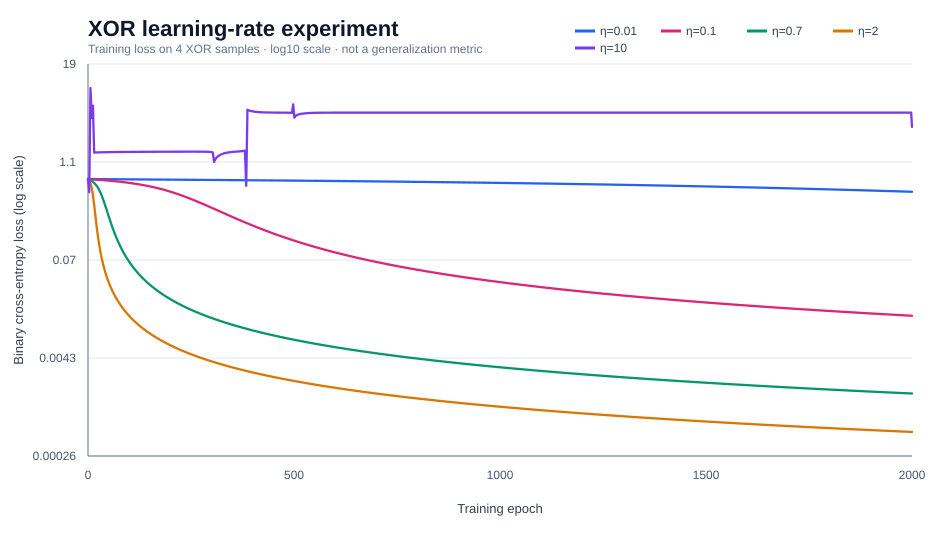
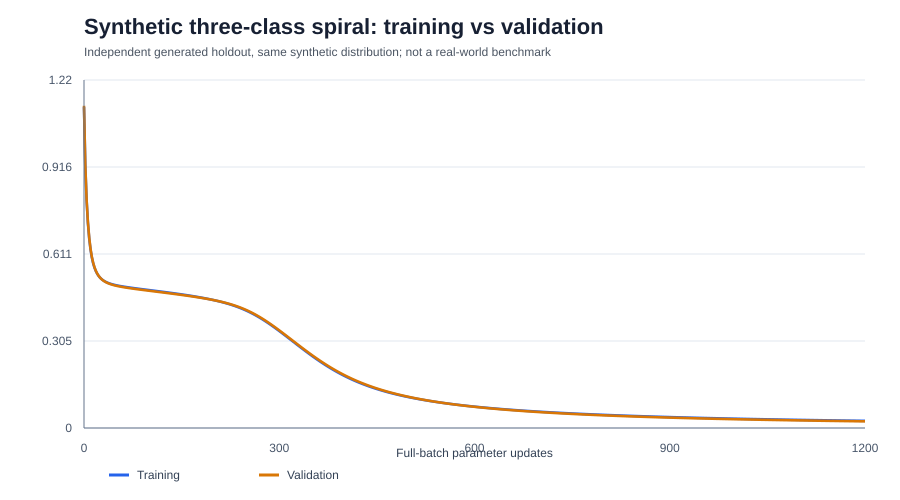

# NumPyNet

**Neural-network training and optimization experiments, implemented with NumPy.**

NumPyNet is a small, inspectable implementation of fully connected neural networks with manual backpropagation. It also provides reproducible experiments to examine gradient correctness, learning-rate behavior, and training-stability interventions.

**Release:** `v0.5.0`<br>
**Requirements:** Python 3.10+ and NumPy 1.26+  
**Scope:** Educational experimentation; not a production machine-learning library.



*Loss curves show training behavior on the four XOR samples. They are not test-set results.*

## Features

- Fully connected (`Dense`) layers and explicit forward/backward propagation
- Sigmoid and Tanh activations, binary cross-entropy, and stochastic gradient descent (SGD)
- Fixed-seed XOR training with repeatable initialization
- Numerical gradient verification using central finite differences
- Training history and comparisons across multiple learning rates and seeds
- Per-update diagnostics: gradient norms, parameter-update ratios, loss increases, and Tanh saturation
- Stability experiments: global gradient clipping, exponential learning-rate decay, and loss-checked backtracking
- CSV result exports, SVG plots, automated tests, and continuous integration
- ReLU and stable Softmax with explicit Jacobian-vector backpropagation
- Fused, logits-based multiclass cross-entropy with analytical gradients
- Three-class synthetic spiral experiment with separately generated validation data

## Installation

Open the folder containing `pyproject.toml` in a terminal. For PowerShell:

```powershell
py -m venv .venv
.\.venv\Scripts\python.exe -m pip install -e .
.\.venv\Scripts\python.exe -m unittest discover -s tests -v
```

## Run experiments

```powershell
.\.venv\Scripts\python.exe -m numpynet trace-neuron
.\.venv\Scripts\python.exe -m numpynet train-xor
.\.venv\Scripts\python.exe -m numpynet check-gradients
.\.venv\Scripts\python.exe -m numpynet compare-lr --epochs 2000
.\.venv\Scripts\python.exe -m numpynet diagnose-lr --rates 2 10 --seeds 7 8 9 --epochs 2000
.\.venv\Scripts\python.exe -m numpynet stabilize-xor --lr 10 --modes baseline clip decay backtrack --seeds 7 8 9 --epochs 2000
.\.venv\Scripts\python.exe -m numpynet check-multiclass-gradients
.\.venv\Scripts\python.exe -m numpynet train-multiclass --epochs 1200 --seed 7
```

Output is written to the ignored `results/` directory. Open `results/stability/loss_seed_7.svg` in a browser to compare interventions. Reference experiment files are provided in [`examples/`](examples/).

## Project structure

```text
src/numpynet/
  activations.py    Activation functions and derivatives
  layers.py         Dense layers and explicit gradients
  losses.py         Binary cross-entropy
  model.py          Sequential forward/backward execution
  optim.py          Parameter updates
  experiments.py    Repeatable training runs
  gradcheck.py      Numerical gradient verification
  diagnostics.py    Per-step optimization measurements
  stability.py      Clipping, schedules, and backtracking
  reports.py        CSV/SVG reports
  lessons.py        Single-neuron calculation trace
  multiclass.py     Three-class datasets, training, numerical checks
  multiclass_reports.py  Multiclass CSV and SVG reports
  cli.py            Command-line interface
examples/           Reference experimental outputs
tests/              Automated tests
docs/               Mathematical notes and experiments
```

## Documentation

- [Architecture](docs/architecture.md)
- [Mathematical notes](docs/math-notes.md)
- [01 — Neuron forward pass and update](docs/lesson-01.md)
- [02 — Numerical gradient verification](docs/lesson-02.md)
- [03 — Learning-rate diagnostics](docs/lesson-03.md)
- [04 — Training-stability experiments](docs/lesson-04.md)
- [05 — Multiclass classification](docs/lesson-05.md)
- [Multiclass architecture](docs/architecture-v05.md)
- [Verification history](docs/evaluation.md)
- [Experimental observations](docs/experiment-04-observations.md)
- [Learning log](docs/learning-log.md)
- [Roadmap](ROADMAP.md)
- [Changelog](CHANGELOG.md)

## Experimental limitations

XOR experiments use **four training samples**; the multiclass demonstration uses an independently generated synthetic spiral validation set. XOR accuracy is training accuracy. The synthetic spiral validation result does not establish performance on real datasets. Repeated initialization seeds reduce dependence on a single run but do not provide a statistically representative evaluation. Backtracking requires extra loss evaluations, so equal training-step counts need not imply equal compute costs.

Gradient clipping, learning-rate decay, and backtracking are established optimization techniques. The repository compares their behavior under controlled settings; it does not introduce a new optimizer.

## Multiclass demonstration

The default three-class example uses 300 synthetic training samples and 180 independently generated validation samples. It uses 2 input coordinates, a hidden Tanh layer, and 3 output logits. A fused Softmax + cross-entropy loss provides a stable gradient. The new `train-multiclass` command exports validation and training histories to `results/multiclass/`. See [Lesson 05](docs/lesson-05.md) for equations and limitations.



## Maintainer

[tkarimdk](https://github.com/tkarimdk)

## License

No open-source license is currently included. The source is publicly viewable if the repository is public, but reuse rights are not automatically granted. NumPy and other external dependencies remain subject to their respective licenses.
